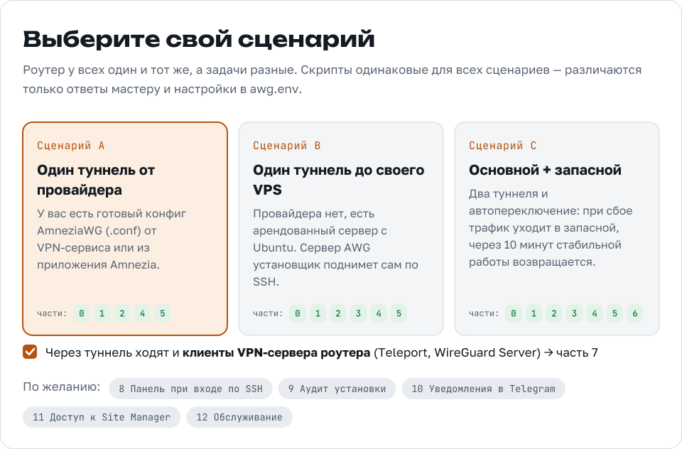

<picture>
  <source media="(prefers-color-scheme: dark)" srcset="assets/readme/hero-dark.svg?v=2">
  
</picture>

<a href="GUIDE.md">
  <picture>
    <source media="(prefers-color-scheme: dark)" srcset="assets/readme/guide-dark.svg?v=2">
    
  </picture>
</a>

В туннель уходят только те устройства, сети и домены, которые вы выбрали в интерфейсе UniFi. Остальной трафик идёт как обычно, через провайдера. Если туннели лежат, трафик под правилами останавливается, а не утекает в WAN.

## ⚡ Установка одной командой

На роутере по SSH под root:

```bash
bash <(curl -fsSL https://raw.githubusercontent.com/lexer86/AmneziaWG3.1-UDR7/main/install.sh)
```

Мастер спросит сценарий, конфиги и опции, проверит каждый шаг и при ошибке предложит варианты. На вопросы отвечайте `yes`/`no` (подходят и `y`/`n`, `да`/`нет`); пустой Enter принимает ответ в квадратных скобках.

<picture>
  <source media="(prefers-color-scheme: dark)" srcset="assets/readme/scenarios-dark.svg">
  
</picture>

| | Что у вас есть | Что делает мастер |
|---|---|---|
| **A** | Конфиг AmneziaWG от VPN-провайдера | Поднимает туннель, подключает его к PBR, ставит сторожа |
| **B** | Свой VPS: Ubuntu/Debian, root, белый IP | Сам заходит на VPS по SSH, собирает и настраивает сервер AWG, забирает конфиг |
| **C** | Конфиг провайдера + свой VPS | Основной и запасной туннель: переключение после трёх неудачных проверок подряд (обычно меньше минуты), возврат через 10 минут стабильной работы |

## 🛠 Обслуживание

```bash
/data/awg/install.sh             # меню: обновление, компоненты, диагностика, удаление
/data/awg/install.sh --update    # обновить скрипты из репозитория, конфиги сохраняются
/data/awg/install.sh --restore   # после обновления прошивки UniFi
/data/awg/install.sh --status    # панель состояния (она же awgs)
/data/awg/install.sh --uninstall
```

С компьютера то же самое запускается через `ssh -t`: установщику нужен терминал.

```bash
ssh -t root@192.168.1.1 '/data/awg/install.sh --update'
```

## 🌐 Доступ к Site Manager UniFi через туннель

`awg-ui-fix.sh` ставит службу `awg-self`: собственный трафик роутера идёт по тем же правилам PBR, что и LAN, а домены `ui.com` резолвятся через AWG. Так Site Manager (unifi.ui.com) перестаёт получать заглушку «Access Prohibited» (HTTP 451). Нужна уже работающая установка.

Установить или обновить:

```bash
bash <(curl -fsSL https://raw.githubusercontent.com/lexer86/AmneziaWG3.1-UDR7/main/awg-ui-fix.sh)
```

Проверить:

```bash
bash <(curl -fsSL https://raw.githubusercontent.com/lexer86/AmneziaWG3.1-UDR7/main/awg-ui-fix.sh) check
```

Удалить:

```bash
bash <(curl -fsSL https://raw.githubusercontent.com/lexer86/AmneziaWG3.1-UDR7/main/awg-ui-fix.sh) uninstall
```

## ✅ Что мастер проверяет

<details>
<summary>Каждый шаг заканчивается проверкой — развернуть список</summary>

- архитектуру (aarch64), UniFi OS, `/dev/net/tun`, нужные команды, место на `/data`, доступ к GitHub;
- остатки старых установок: обычный WireGuard `wgbackup`, тестовые правила, чужой установщик `/data/awg-native`, ручные экземпляры сторожа (предлагает убрать);
- бинарники AmneziaWG: что они запускаются на роутере;
- конфиг: секции, ключи, `Address`, `Endpoint`; предупреждает, если это обычный WireGuard без обфускации;
- туннель: внешний IP через интерфейс и handshake; при сбое — tcpdump на WAN, а для своего VPS одновременно и на сервере, с выводом причины (порт у хостера, ключи, параметры обфускации, DPI);
- PBR: находит таблицу, метку и профиль VPN Client; если правила нет — создаёт фиктивный профиль-«рельсу» и показывает, что сделать в UniFi;
- сторожа: маршрут в таблице PBR вместе с `blackhole`, чтобы при падении туннелей не было утечки в WAN;
- переключение на запасной канал (по желанию, имитацией сбоя);
- Telegram: токен через `getMe`, chat id автоматически, тестовое сообщение.

</details>

## 🩺 Если что-то не так

| Что сделать | Команда |
|---|---|
| Проверить всю установку | `awg-audit` или `/data/awg/audit.sh` |
| Диагностика туннелей с двух сторон | `/data/awg/install.sh` → «Диагностика» |
| Клиенты Teleport / WireGuard Server | `/data/awg/subnets.sh check` |
| Доступ к Site Manager (unifi.ui.com) | `/data/awg/self.sh check` |
| Журнал переключений | `tail -n 30 /data/awg/failover.log` |

Разбор типовых проблем — в части 12 гайда, [«Диагностика и проблемы»](GUIDE.md#p12).

## 📁 Структура

```
install.sh            установщик и меню обслуживания
awg-ui-fix.sh         по желанию: Site Manager (unifi.ui.com) и трафик самого роутера через AWG
index.html            гайд (GitHub Pages): ручная установка, диагностика, справочник
VERSION
awg/                  файлы роутера → /data/awg
  up.sh                 поднять туннели из main.conf / backup.conf
  failover.sh           сторож: таблица PBR, проверки, переключение
  awg-detect.sh         найти таблицу, метку, профиль PBR → awg.env
  status.sh             панель (awgs)
  audit.sh              аудит (awg-audit)
  notify.sh, awg-notify.sh   Telegram
  awg-restore.sh        восстановление после обновления прошивки
  awg-uninstall.sh      удаление
  *.service             юниты systemd (копии в /data/awg)
server/               файлы VPS
  awg-server-build.sh   сборка amneziawg-go и awg
  awg-server-setup.sh   ключи, обфускация, служба awg-server
  audit-server.sh       аудит VPS
assets/readme/        картинки этого README
```

`subnets.sh` (клиенты VPN-сервера роутера) установщик создаёт сам, `self.sh` ставит `awg-ui-fix.sh`.

## 🧪 Что проверено

- **Вживую на UDR7** (UniFi OS 5.1.33, Network 10.6.106): схема целиком — основной туннель от провайдера по протоколу AmneziaWG 3.1, запасной до своего VPS (Ubuntu 24.04), PBR по доменам и адресам, клиенты VPN-сервера роутера, переключение и возврат, панель, аудит, уведомления, доступ к Site Manager.
- **На заглушках:** установщик и универсальные версии скриптов (сценарии A, B, C, ошибки конфигов, диагностика, повторное использование сервера, обновление, восстановление, удаление). На чужом роутере они ещё не запускались — сообщайте о проблемах в [Issues](https://github.com/lexer86/AmneziaWG3.1-UDR7/issues).

## 🔒 Безопасность

> [!IMPORTANT]
> **Один конфиг AmneziaWG = одно устройство.** Если один ключ работает на двух клиентах сразу, сервер перекидывает endpoint между ними, и оба канала становятся нестабильными.

- Конфиги и токены не отправляются в чаты и тикеты; файлы с ключами получают права `600`.
- Бинарники для роутера берутся из [AmneziaWG-Unifi-DreamMachine](https://github.com/DjGreeZ/AmneziaWG-Unifi-DreamMachine) (только `bin/`, его установщик не используется). Сборка из исходников описана в гайде.
- Изменения через CLI выходят за штатную работу устройства. `install.sh --uninstall` убирает всё, что поставил установщик.

> [!NOTE]
> Все материалы и демонстрации представлены исключительно в образовательных и исследовательских целях для повышения цифровой грамотности. Автор не одобряет и не призывает к неправомерным действиям. Любые действия, совершённые на основе этой информации, вы делаете на свой страх и риск.
